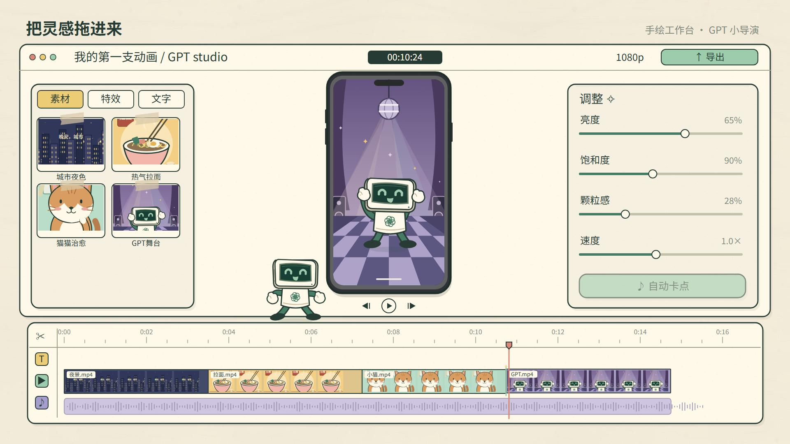
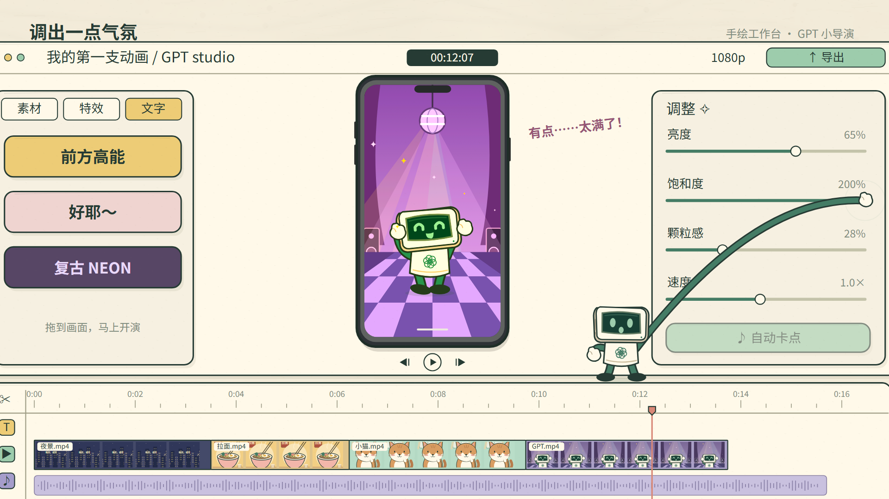
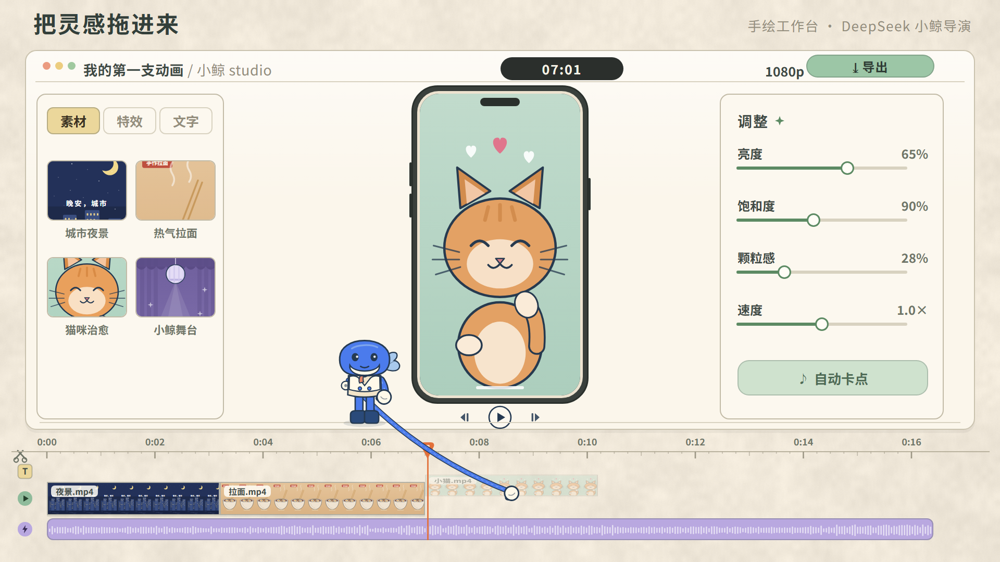
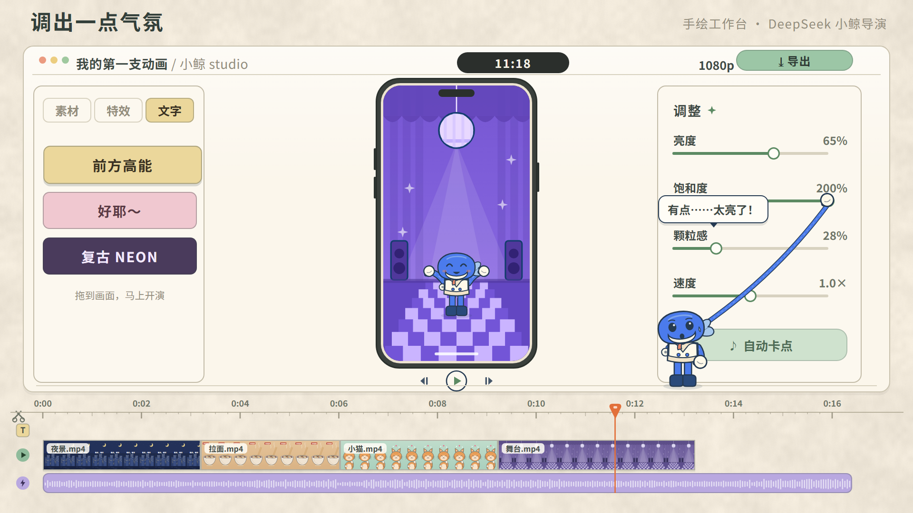

# remotion_anime

用 Agent 把参考动画拆成可编辑的 React / SVG / Remotion 场景：分析参考 → 设计角色 → 生成预览 → 提具体意见 → 重渲染。

这里公开教程中展示的 **Codex 与 DeepSeek 两份 V4 工作台动画**，各 30.6 秒、1920×1080、30fps，有节奏配乐，无旁白。包含源码、可直接使用的素材、音乐生成脚本、提示词和迭代记录。

| Codex · 终端机器人 | DeepSeek · 蓝白小鲸 |
|---|---|
|  |  |

灵感与参考原作来自 **大师的AI小灶**。这是独立实现的学习复刻，未附带原作者的视频、音乐或代码，也不代表品牌官方作品。原作完整提示词和制作轮次未知。

## 快速开始

安装 Node.js 20 或更新版本（推荐 22 LTS），然后：

```bash
git clone https://github.com/Luna-AI-Infra/remotion_anime.git
cd remotion_anime
npm ci
npm test
npm run render -- all
```

输出：`out/codex-v4.mp4`、`out/deepseek-v4.mp4`。

```bash
npm run render -- codex       # 只渲染机器人
npm run render -- deepseek    # 只渲染小鲸
npm run stills               # 重做本文预览图
npm run studio               # 自己打开交互预览
npm run typecheck
```

首次安装及渲染需要联网下载 npm 包与 Remotion 使用的浏览器；Linux 可能需补齐 Chromium 系统依赖。正常渲染不需要 API Key、模型服务、Python 或原参考视频。配乐和纸纹已经放入 `public/`，字体随 npm 包本地加载。

## 从参考到作品

1. **先分析再写代码。** 抽取关键帧，观察画幅、纸色、描边、分层、角色接触点与操作顺序；把可观察的效果和推测的技术栈分开。
2. **先定角色。** 生成三版风格稿，选择 C 终端机器人，再用 SVG 分解身体、手套、腿和表情；小鲸单独设计。
3. **先跑通完整片。** 用帧号驱动导入、删除、转场、标题撤销、饱和度回调、卡点、导出和展示八段操作。
4. **用可见问题给反馈。** 手要真正接触控件；饱和度影响手机画面；播放头和手机同源；素材无缝拼接；静态内容加入细微动作。
5. **重新渲染并核对。** 检查时间轴状态，再看接触帧、表情和节奏。测试能验证同步，不能替代观看与核听。

详见 [制作流程与实现入口](docs/workflow.md)、[提示词与修改意见](docs/prompts.md)、[素材清单](docs/assets.md)、[验证记录](docs/verification.md)。

### 风格选择

| A · 薄荷方块 | B · 结形吉祥物 | C · 终端机器人（选用） |
|---|---|---|
|  |  |  |

这些是 AI 生成的概念稿。最终动画使用可编辑 SVG，不依赖把设计图逐帧变成视频。

### 操作中的画面

| 导入 | 调色与反馈 |
|---|---|
|  |  |
|  |  |

## 谁完成了什么

- Codex 路线：作者记录使用 GPT-6 Astra / ultra，按参考分析、角色设计和反馈迭代完成。
- DeepSeek 路线：初版由 DeepSeek V4.1 Flash 通过 Claude Code 制作；**本仓库 V4 的后续完善由 Codex 完成**。
- V4 是项目版本号，不表示恰好四次提示词。这不是两模型输入、工具和轮次完全相同的独立能力测试。
- 本仓库从两份 V4 提取，移除了工作台插件依赖，改用统一的开放字体；内容与时序保留，字体排版可能与 Windows 原成片略有区别。

## 许可证

本项目自身代码及自制素材按 [MIT](LICENSE) 提供；第三方依赖与品牌标识的权利不因此转移。Remotion 有独立许可条款，使用前请查看 [官方许可说明](https://www.remotion.dev/docs/license/pricing)。字体及来源说明见 [THIRD_PARTY_NOTICES](THIRD_PARTY_NOTICES.md)。
