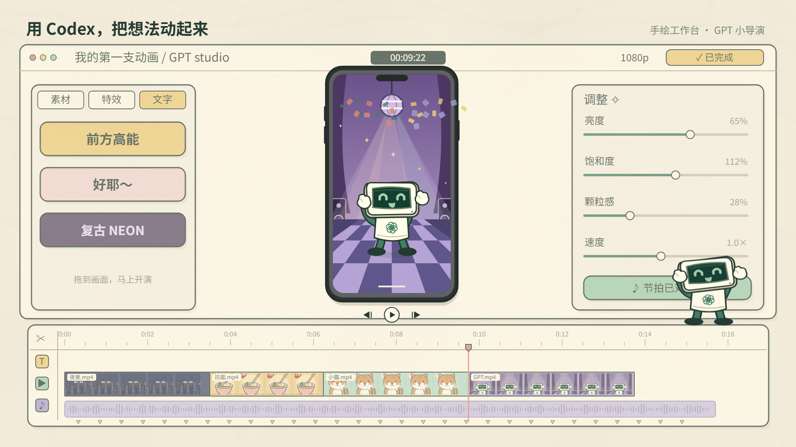
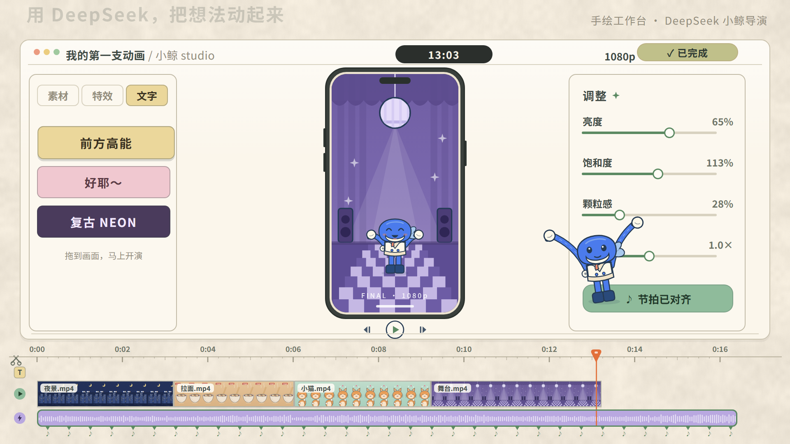
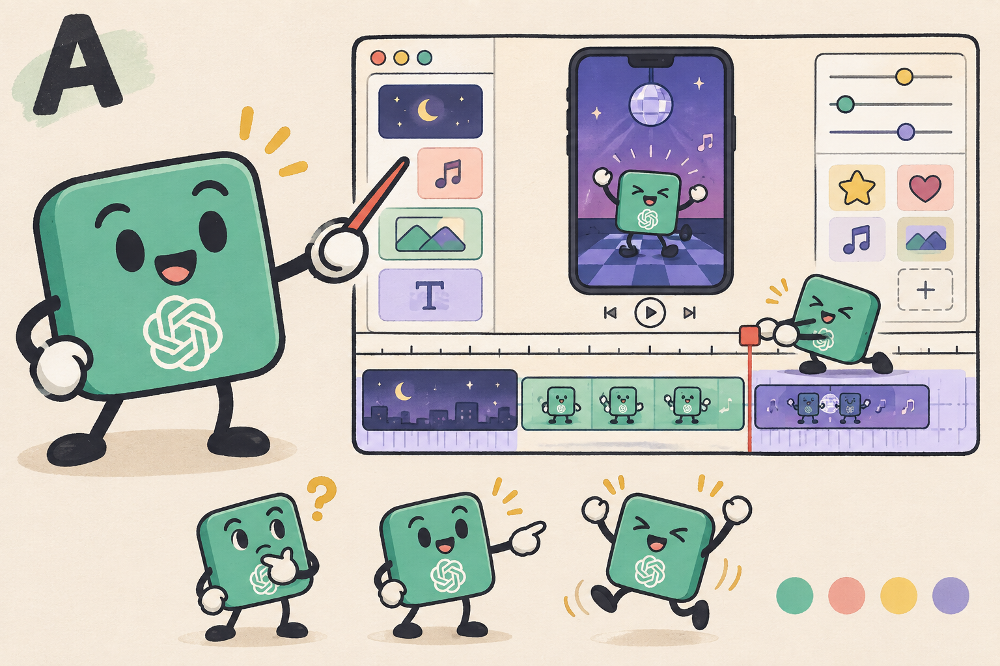
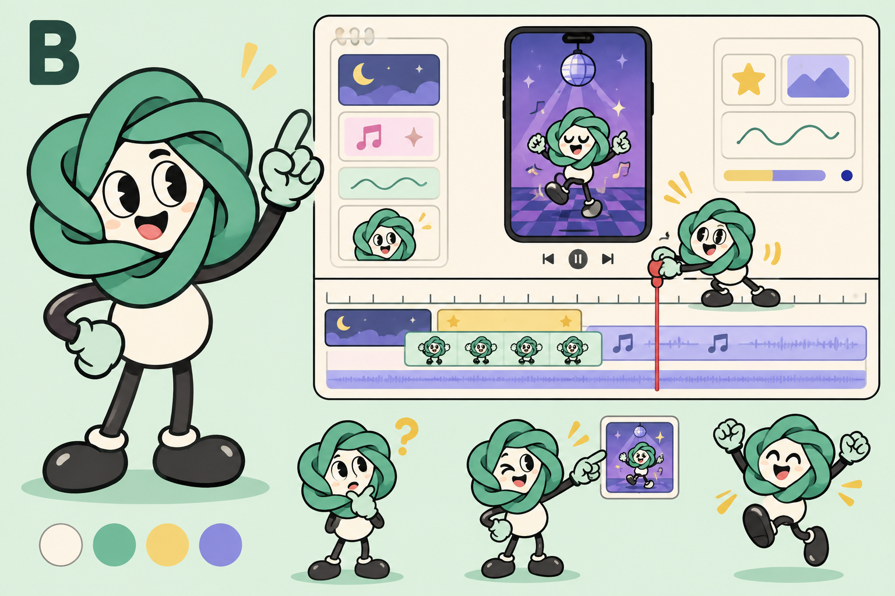
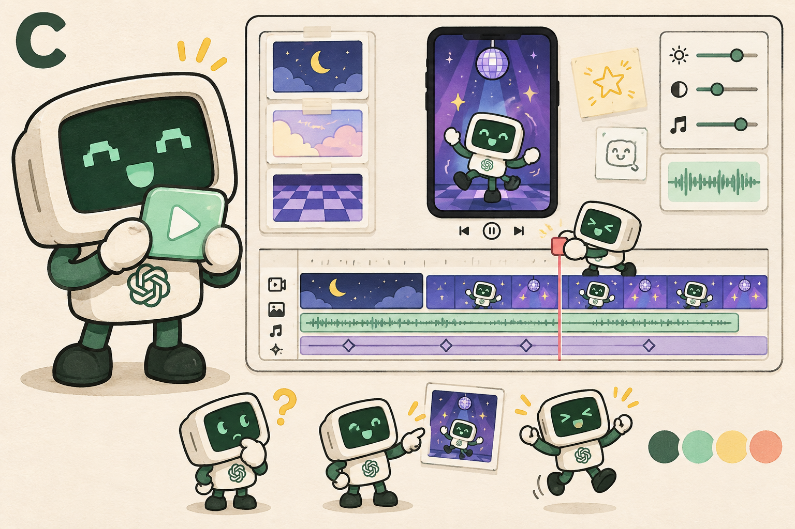

# remotion_anime

用 Agent 分析参考视频，再用 **React + SVG + Remotion** 做出自己的纸感角色动画。

仓库包含两套工作台动画、完整源码、素材、配乐生成脚本和提示词。每支动画约 31 秒，1920×1080、30fps，有配乐，无旁白。

| Codex · 终端机器人 | DeepSeek · 蓝白小鲸 |
|---|---|
|  |  |

参考原作：**大师的AI小灶**。机器人动画由 Codex 制作；小鲸动画由 DeepSeek 起稿、Codex 后续完善。仓库不包含原作者的视频、音乐或代码。

## 快速开始

需要 Node.js 20 或以上。

```bash
git clone https://github.com/Luna-AI-Infra/remotion_anime.git
cd remotion_anime
npm ci
npm run render -- all
```

两份 MP4 输出到 `out/`。

```bash
npm run render -- codex       # 只渲染机器人
npm run render -- deepseek    # 只渲染小鲸
npm run stills               # 重做本文预览图
npm run studio               # 自己打开交互预览
npm test                     # 检查播放头、手机画面与片段拼接
```

首次运行需要联网下载依赖和渲染浏览器。素材、配乐与字体已随项目提供，渲染不需要 API Key 或模型服务。

## 从参考到作品

1. **分析参考：** 抽取关键帧，拆解配色、角色动作、交互顺序与节奏。
2. **设计角色：** 生成风格候选，选定形象后拆成可编辑的 SVG 部件。
3. **制作预览：** 用帧号驱动工作台操作，让角色、手机画面和时间轴同步。
4. **反馈打磨：** 针对手部接触、滤镜反馈、片段拼接和动作踩点逐项修改，再渲染检查。

照着做：[制作流程与代码入口](docs/workflow.md) · [提示词与修改意见](docs/prompts.md) · [素材清单](docs/assets.md)

### 风格选择

| A · 薄荷方块 | B · 结形吉祥物 | C · 终端机器人（选用） |
|---|---|---|
|  |  |  |

概念稿由 AI 生成，最终动画使用 SVG 绘制。完整设计提示词见 [design-prompts.json](docs/prompts/design-prompts.json)。

## 许可证

项目代码与自制素材采用 [MIT](LICENSE)。Remotion 遵循其[官方许可](https://www.remotion.dev/docs/license/pricing)；字体与其他来源见 [第三方说明](THIRD_PARTY_NOTICES.md)。
